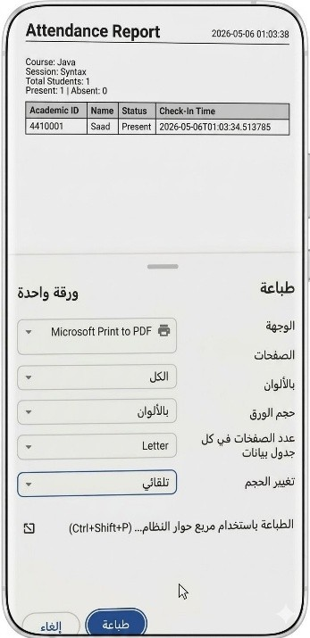
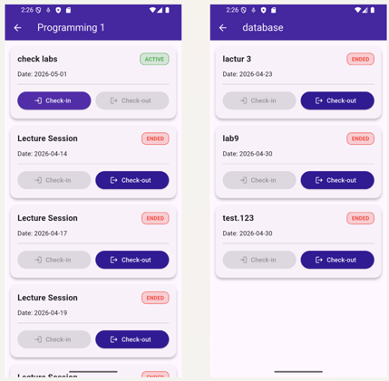
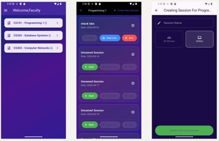

# IAttend – Intelligent Attendance Management System

## Project Overview

IAttend is a smart attendance management system developed to improve attendance verification in higher education institutions.

The system combines facial recognition and GPS-based location verification to ensure that students are correctly identified and physically present at the lecture location when recording their attendance.

IAttend provides a unified mobile application with role-based interfaces for students and faculty members, making attendance management more secure, efficient, and convenient.

## Problem Statement

Traditional attendance systems in universities can be time-consuming, inefficient, and vulnerable to proxy attendance. Manual attendance recording also creates additional work for faculty members and makes attendance tracking less efficient.

## Proposed Solution

IAttend provides an automated attendance management solution using facial recognition and location verification. This approach helps verify student identity and physical presence before recording attendance.

## Project Preview

Watch the IAttend project walkthrough video to explore the system's main features and user flow.

[Watch IAttend Project Walkthrough](https://youtu.be/--7hJHmCb1k)

## Key Features

### Student Features

- User account creation and login.
- Facial verification for attendance check-in.
- GPS-based location validation.
- Attendance history tracking.
- Course management.
- Attendance confirmation and status updates.

### Faculty Features

- Faculty account login.
- Create and manage attendance sessions.
- Course and session management.
- Enable or disable location verification depending on session type.
- Real-time attendance monitoring.
- Attendance record management.
- PDF attendance reports.

## How It Works

IAttend uses a multi-factor verification approach:

1. **Face Verification:** The system verifies the student's identity using a FaceNet-based Siamese Network.
2. **Location Verification:** The student's current GPS coordinates are compared with the classroom location using the Haversine Formula.
3. **Attendance Recording:** Once the required verification steps are completed, the attendance record is updated and the student receives a confirmation.

For online sessions, facial verification is used without location validation.


## Technology Stack

| Component | Technologies |
|---|---|
| Mobile Application | Flutter, Dart |
| Backend | Python, FastAPI |
| Database | Supabase, PostgreSQL |
| Authentication & Storage | Supabase |
| Face Recognition | FaceNet (InceptionResNetV1), Siamese Network |
| Machine Learning | TensorFlow, Keras |
| Location Services | Geolocator API, Haversine Formula |

## System Architecture

IAttend follows a client-server architecture:

- **Frontend:** Flutter mobile application for students and faculty.
- **Backend:** FastAPI handles application requests, attendance processing, facial verification, and location validation.
- **Database:** Supabase with PostgreSQL stores user information, facial data, and attendance records.
- **Storage:** Supabase Storage manages uploaded files.

## Project Screenshots

The following screenshots showcase the main interfaces and features of the IAttend system.










## My Contribution

- Developed the database implementation (`database.py`).
- Worked on user account creation and login functionality.
- Implemented session creation and management.
- Worked on face verification functionality.
- Contributed to location verification.
- Worked on attendance history and course session features.
- Contributed to faculty session functionality.

## Project Structure

```text
IAttend-System/
│
├── frontend/
│   └── Flutter Mobile Application
│
├── backend/
│   └── FastAPI Backend
│
├── screenshots/
│   └── Project interface screenshots
│
└── README.md
```

## Model Weights

The trained face verification model weights are available on Google Drive:

[Download Face Recognition Model Weights](https://drive.google.com/drive/folders/1jfJhwT7-lW_qHmVosvwFKDR7Eq-vOymX?usp=sharing)

## Project Information

- **Project Type:** Graduation Project
- **University:** Taibah University
- **Field:** Computer Science
- **Project Team:** Collaborative Team Project
