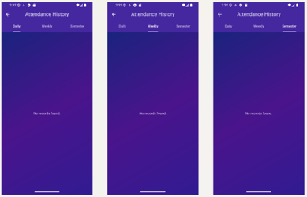
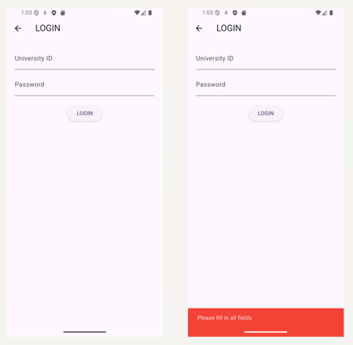
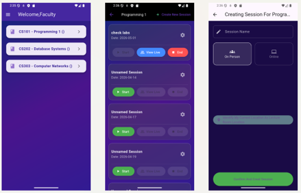
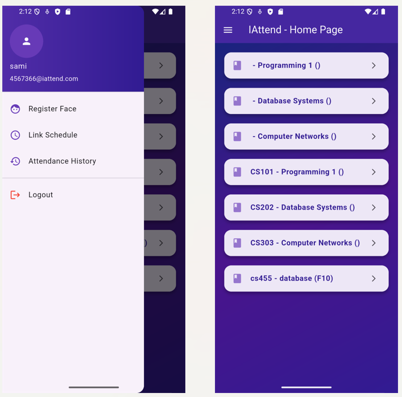
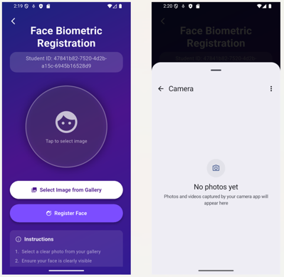
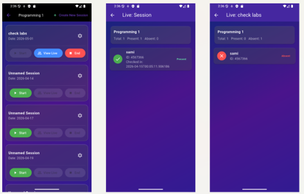
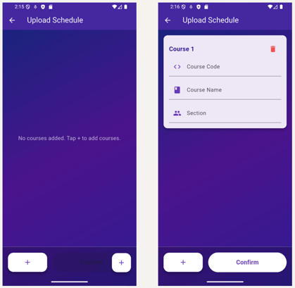

# IAttend – Intelligent Attendance Management System

**IAttend** is a mobile-based smart attendance management system designed for higher education institutions. It combines facial verification with GPS-based location validation to help verify students' identities and physical presence before recording attendance.

The system provides separate workflows for students and faculty members, including face registration, attendance sessions, course and schedule management, live attendance monitoring, attendance history, and PDF reports.

## Project Links

- **GitHub Repository:** [hanan-alharbi-cs/IAttend-System](https://github.com/hanan-alharbi-cs/IAttend-System)
- **Project Walkthrough Video:** [Watch the IAttend Project Walkthrough](https://youtu.be/--7hJHmCb1k)
- **Final Project Report:** [View Project Documentation](docs/IAttend-Project-Report.pdf)
- **Face Verification Model Weights:** [Access Trained Model Weights](https://drive.google.com/drive/folders/1jfJhwT7-lW_qHmVosvwFKDR7Eq-vOymX?usp=sharing)

> The project walkthrough video explains the system, its main features, and the user flow. It is not presented as a live interactive demo.

---

## Project Overview

IAttend aims to improve attendance management by reducing manual attendance procedures and helping prevent proxy attendance.

The system combines two verification factors:

1. **Facial Verification:** Verifies the student's identity using a FaceNet-based Siamese Network.
2. **Location Verification:** Validates the student's geographical position using GPS coordinates and the Haversine Formula.

The mobile application supports both student and faculty roles, allowing students to register their faces and record attendance, while faculty members can create and manage attendance sessions and monitor attendance records.

## Problem Statement

Traditional attendance systems in universities can be time-consuming, inefficient, and vulnerable to proxy attendance.

Manual attendance recording also creates additional administrative work for faculty members and makes it more difficult to manage attendance records across multiple courses and lecture sessions.

A more reliable approach is needed to verify student identity and physical presence while simplifying attendance management for both students and faculty members.

## Proposed Solution

IAttend provides an automated attendance management solution using facial verification and GPS-based location validation.

Before recording attendance, the system performs the required verification steps according to the session configuration.

Faculty members can enable or disable location verification depending on the session type.

For online sessions, facial verification can be used without location validation.

The system also provides attendance history, course management, schedule uploading, live monitoring, and PDF reporting.

---

## Key Features

### Student Features

- User account creation and login.
- Facial image registration.
- Facial verification for attendance check-in.
- GPS-based location validation when required.
- Attendance history tracking.
- Course session viewing and management.
- Course schedule uploading.
- Attendance confirmation and status updates.

### Faculty Features

- Faculty account login.
- Create and manage attendance sessions.
- Course and session management.
- Enable or disable location verification depending on session type.
- Real-time attendance monitoring.
- Attendance record management.
- Attendance history review.
- PDF attendance report generation.

---

## How It Works

IAttend follows a multi-factor attendance verification workflow.

### 1. Face Registration

Students register their facial images through the Flutter mobile application.

The selected image is uploaded to the backend for processing and enrollment.

### 2. Face Detection and Processing

The face-processing workflow uses OpenCV for image handling and MTCNN in the model training and testing workflow for face detection.

### 3. Facial Verification

The system uses a FaceNet-based Siamese Network built with TensorFlow and Keras.

The FaceNet implementation uses the InceptionResNetV1 architecture to generate facial representations.

The face-verification service compares facial representations using Euclidean distance to support the matching decision.

### 4. Location Verification

The Flutter application retrieves the device's current geographical position using the Geolocator package.

The Haversine Formula is used to calculate the geographical distance between the student's current location and the lecture location.

Location verification is performed when enabled for the attendance session.

### 5. Attendance Recording

After the required verification steps are completed, the attendance workflow submits the attendance record through the backend.

Students receive attendance status information through the mobile application.

For online sessions, location validation can be disabled while facial verification remains available.

---

## Technology Stack

### Mobile Application

| Component | Technologies |
|---|---|
| Programming Language | Dart |
| Mobile Framework | Flutter |
| UI Development | Flutter Material |
| Camera Integration | Camera |
| Image Selection | Image Picker |
| HTTP Communication | HTTP, http_parser |
| Local Preferences | Shared Preferences |
| Location Services | Geolocator |
| Reports | PDF, Printing |
| File Handling | File Picker |

### Backend Development

| Component | Technologies |
|---|---|
| Programming Language | Python |
| Backend Framework | FastAPI |
| ASGI Server | Uvicorn |
| Data Validation | Pydantic |
| Multipart Requests | python-multipart |
| Environment Configuration | python-dotenv |
| Database ORM | SQLModel, SQLAlchemy |
| Database | PostgreSQL |
| Backend Integration | Supabase Python Client |

### Artificial Intelligence & Computer Vision

| Component | Technologies |
|---|---|
| Face Recognition | FaceNet |
| Face Embedding Architecture | InceptionResNetV1 |
| Neural Network Architecture | Siamese Network |
| Deep Learning Framework | TensorFlow |
| Deep Learning API | Keras |
| Face Detection | MTCNN |
| Computer Vision | OpenCV |
| Image Processing | Pillow, NumPy |
| Similarity Measurement | Euclidean Distance using SciPy |

### Model Training & Evaluation

| Component | Technologies |
|---|---|
| Data Processing | NumPy, Pandas |
| Machine Learning Metrics | scikit-learn |
| Model Evaluation | Accuracy, Precision, Recall, F1-score, Confusion Matrix |
| Visualization | Matplotlib, Seaborn |
| Progress Monitoring | tqdm |

### Database & Storage

- Supabase
- PostgreSQL
- Supabase Client
- Supabase Storage
- SQLModel
- SQLAlchemy

---

## Model Development & Evaluation

The repository includes dedicated scripts for face-verification model development, training, and testing.

The model workflow uses:

- **FaceNet:** Facial feature representation.
- **InceptionResNetV1:** FaceNet architecture used in the face encoder.
- **Siamese Network:** Face-verification model architecture.
- **MTCNN:** Face detection in model training and testing scripts.
- **OpenCV:** Image processing.
- **TensorFlow/Keras:** Model implementation and training.
- **SciPy:** Euclidean distance calculations.
- **scikit-learn:** Model evaluation metrics.
- **Pandas and NumPy:** Data processing and numerical operations.
- **Matplotlib and Seaborn:** Evaluation visualization.

The model testing scripts evaluate face-matching results using accuracy, precision, recall, F1-score, classification reports, and confusion matrices.

The trained face-verification model weights are provided through the Google Drive link in the Project Links section.

---

## System Architecture

IAttend follows a client-server architecture consisting of a Flutter mobile application, a FastAPI backend, facial verification services, and database integrations.

### Frontend – Flutter Mobile Application

The Flutter application provides student and faculty interfaces.

It handles:

- User authentication workflows.
- Face registration and image selection.
- Camera-based face verification.
- GPS location retrieval.
- Attendance session interaction.
- Course and schedule management.
- Attendance history and PDF reporting.

### Backend – FastAPI

The backend handles application requests and business logic through FastAPI.

Its responsibilities include:

- User and faculty-related workflows.
- Authentication-related operations.
- Attendance session creation and management.
- Face registration and verification requests.
- Location verification workflows.
- Course and schedule processing.
- Attendance record management.

### Database Layer

The database layer uses SQLModel and SQLAlchemy for database models and operations.

PostgreSQL is used as the relational database, with Supabase services integrated into the application for database-related and storage functionality.

### Face Verification Service

The face-verification service uses TensorFlow/Keras and a FaceNet-based Siamese Network.

OpenCV and NumPy support image-processing operations, while Euclidean distance is used in the matching workflow.

### Location Verification

The mobile application uses Geolocator to retrieve device coordinates.

The Haversine Formula calculates the geographical distance between the student and the lecture location.

---

## Project Screenshots

The following screenshots showcase the main interfaces and features of the IAttend system.

### 1. Attendance History



### 2. Attendance Reports


### 3. Course Sessions


### 4. Error Screen



### 5. Login Error Screen


### 6. On-Person Attendance Session



### 7. Student Home Screen



### 8. Face Registration



### 9. Online Session Creation


### 10. Live Attendance Monitoring



### 11. Schedule Upload



---

## My Contribution

My contributions to the collaborative graduation project included:

- Developed the database implementation in `database.py` and worked with SQLModel database models.
- Worked on user account creation and login functionality.
- Implemented attendance session creation and management.
- Worked on face registration and facial verification functionality.
- Contributed to GPS-based location verification.
- Worked on attendance history and course session features.
- Contributed to faculty session functionality and attendance workflows.

---

## Project Structure

```text
IAttend-System/
│
├── backend/
│   │
│   ├── ai_lab/
│   │   └── train_model.py
│   │
│   ├── src/
│   │   ├── main.py
│   │   ├── database.py
│   │   ├── models.py
│   │   ├── login.py
│   │   ├── creat_leacture.py
│   │   ├── face_service.py
│   │   ├── siamese_model.py
│   │   ├── Rigeaster_face_biomatric.py
│   │   ├── model_testing.py
│   │   └── schedule_service.py
│   │
│   ├── weights/
│   │
│   └── requirements.txt
│
├── frontend/
│   │
│   ├── lib/
│   │   ├── main.dart
│   │   ├── login_page.dart
│   │   ├── creat_account.dart
│   │   ├── student_home_page.dart
│   │   ├── faculty_home_page.dart
│   │   ├── create_session_page.dart
│   │   ├── FacultySessionsPage.dart
│   │   ├── course_sessions_page.dart
│   │   ├── face_verification_page.dart
│   │   ├── register_face_page.dart
│   │   ├── attendance_orchestrator.dart
│   │   ├── location.dart
│   │   ├── live_attendance_page.dart
│   │   ├── upload_schedule_page.dart
│   │   └── view_attendance_history_page.dart
│   │
│   ├── pubspec.yaml
│   └── pubspec.lock
│
├── docs/
│   └── IAttend-Project-Report.pdf
│
├── screenshots/
│   ├── Attendance History screen.png
│   ├── Attendance Reports screen.jpg
│   ├── Course Sessions screen.png
│   ├── Error screen.png
│   ├── LogIn Error Screen.png
│   ├── On-Person attendance session.png
│   ├── Student Home screen.png
│   ├── Students register their face.png
│   ├── creates an Online session.png
│   ├── monitors Live Attendance.png
│   └── uploads a schedule.png
│
└── README.md
```

---

## Installation & Setup

### Prerequisites

Make sure the following tools are installed:

- Python
- Flutter SDK
- Dart SDK
- Git
- PostgreSQL / Supabase configuration
- Android Studio or Visual Studio Code

### 1. Clone the Repository

```bash
git clone https://github.com/hanan-alharbi-cs/IAttend-System.git

cd IAttend-System
```

### 2. Set Up the Backend

Navigate to the backend directory:

```bash
cd backend
```

Create and activate a Python virtual environment.

**Windows:**

```bash
python -m venv venv

venv\Scripts\activate
```

**macOS / Linux:**

```bash
python3 -m venv venv

source venv/bin/activate
```

Install the backend dependencies:

```bash
pip install -r requirements.txt
```

Configure the required environment variables for the database and Supabase integration before running the backend.

### 3. Run the Backend

From the appropriate project directory, start the FastAPI application using Uvicorn.

The backend entry point is:

```text
backend/src/main.py
```

The application uses FastAPI and Uvicorn to expose the backend services.

### 4. Set Up the Flutter Application

Open a new terminal and navigate to the frontend directory:

```bash
cd frontend
```

Install Flutter dependencies:

```bash
flutter pub get
```

### 5. Run the Mobile Application

Check the available devices:

```bash
flutter devices
```

Run the application:

```bash
flutter run
```

---

## Project Information

- **Project Type:** Graduation Project
- **University:** Taibah University
- **Field:** Computer Science
- **Project Team:** Collaborative Team Project
- **Application Type:** Mobile-Based Attendance Management System

---

## Notes on Dependencies

The backend requirements file and Flutter dependency manifest describe the application dependencies.

Some libraries referenced by the model training and testing source files, including MTCNN, SciPy, Pandas, scikit-learn, Matplotlib, Seaborn, and tqdm, are not all currently listed in `backend/requirements.txt`.

These packages should be added to the backend requirements file when preparing a complete environment for model training and evaluation.

The project also requires valid database and Supabase configuration before the backend can be run successfully.

---

**IAttend – Combining Facial Verification and Location Validation for Smarter Attendance Management.**
